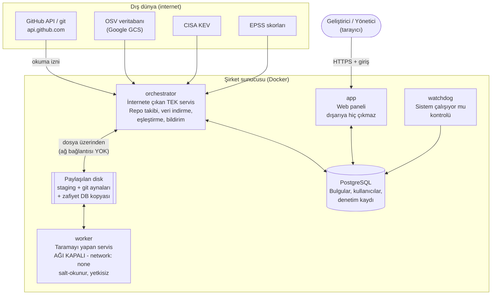
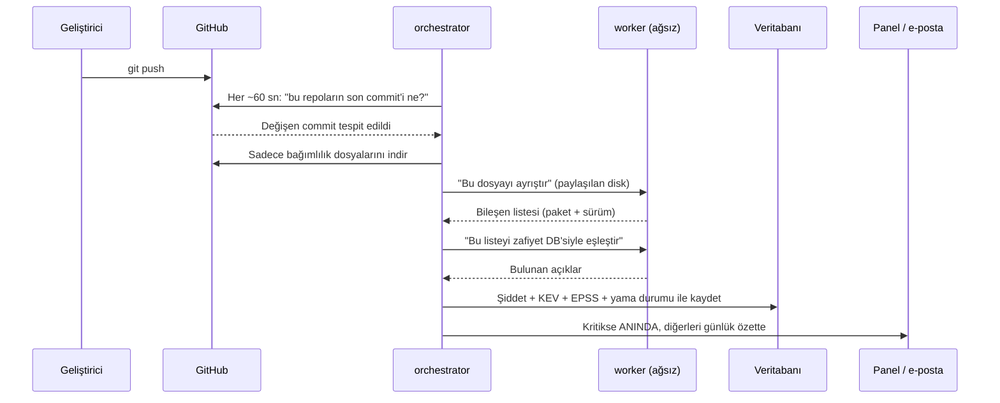

# Scanner Panel — Genel Bakış ve Teknik İşleyiş

Bu belge uygulamanın **ne yaptığını, nasıl çalıştığını, neye ihtiyaç duyduğunu
ve hangi riskleri taşıdığını** teknik olmayan bir yöneticinin de takip
edebileceği bir dille anlatır. Her bölümdeki iddialar kodun kendisine
dayanır; ilgili dosya adları parantez içinde verilmiştir.

> Belgedeki "doğrulanmadı / bilinen sınır" notları kasıtlıdır. Bir güvenlik
> aracının kendi kör noktalarını gizlemesi, aracın kendisinden daha büyük bir
> risktir. Ayrıntılı liste: `docs/LIMITATIONS.md`, `docs/THREAT_MODEL.md`.

---

## 1. Tek paragrafta özet

Şirketin GitHub repolarını otomatik olarak izleyen, her commit sonrası
**(a) bağımlılıklardaki bilinen güvenlik açıklarını** ve **(b) koda
yanlışlıkla girmiş sırları (API anahtarı, şifre, token)** bulup
geliştiricilere anlaşılır bir listede sunan, şirket içinde (kendi
sunucumuzda) çalışan bir web uygulaması. Amaç "mümkün olduğunca çok bulgu"
değil, **gerçekten önemli ve aksiyon alınabilir** bulgu üretmektir: yaması
olmayan açıklar ayrıca işaretlenir, şüpheli sonuçlar otomatik kapatılmaz,
hiçbir bulgu güvenilmeyen veriyle kapatılmaz.

---

## 2. Neyi tarıyor?

Uygulama iki ayrı tarama hattı çalıştırır:

| | **SCA (bağımlılık taraması)** | **Secret taraması** |
|---|---|---|
| Soru | "Kullandığımız kütüphanelerin hangisinde bilinen güvenlik açığı var?" | "Koda yanlışlıkla bir API anahtarı/şifre girmiş mi?" |
| Girdi | Lockfile'lar (bağımlılık listeleri) | Repo'nun tüm git geçmişi |
| Motor | OSV-Scanner | Gitleaks |
| Çıktı | CVE/GHSA + CVSS + yama durumu | Kural tipi + dosya + satır |

### SCA tarafında desteklenen ekosistemler

npm, PyPI (Python), Go, crates.io (Rust), Packagist (PHP), Maven (Java),
NuGet (.NET), RubyGems.

Okunan dosyalar (`orchestrator/extraction.py`): `package-lock.json`,
`yarn.lock`, `poetry.lock`, `Pipfile.lock`, `Cargo.lock`, `composer.lock`,
`Gemfile.lock`, `go.mod`, `packages.lock.json`, `gradle.lockfile`.

> **Önemli sınır:** `pom.xml` (Maven) bir lockfile değildir — sürüm
> aralıkları içerebilir. Bu yüzden ondan çıkan sonuçlar "doğrulanmış"
> sayılmaz, "lockfile yok" olarak işaretlenir (`docs/ASSUMPTIONS.md` #5).
> Java projeleri için en güvenilir sonuç `gradle.lockfile` ile alınır.

---

## 3. Hangi hazır araçlardan yararlanıyoruz?

Hiçbir zafiyet veritabanını kendimiz üretmiyoruz; endüstri standardı,
ücretsiz ve açık kaynaklı kaynakları kullanıyoruz.

### Tarama motorları (worker içinde çalışır)

| Araç | Sürüm | Görevi | Neden bu? |
|---|---|---|---|
| **OSV-Scanner** (Google) | v2.7.0 | Bağımlılık → bilinen açık eşleştirmesi | Google'ın açık kaynak zafiyet veritabanı OSV'nin resmi tarayıcısı; **çevrimdışı** çalışabiliyor |
| **Gitleaks** | 8.30.1 | Git geçmişinde sır (secret) arama | Yaygın standart, yerel `git log` üzerinden çalışır, ağ gerektirmez |

Her iki ikili dosya da imaj kurulurken **sürümü sabitlenmiş ve SHA-256
sağlaması doğrulanmış** şekilde indirilir (`deploy/Dockerfile.worker`) —
yani "bir gün başka bir şey inmiş olma" riski kapalıdır.

### Zafiyet / risk veri kaynakları (günde 1 kez indirilir)

| Kaynak | Ne sağlıyor |
|---|---|
| **OSV veritabanı** (Google GCS) | Hangi paketin hangi sürümünde hangi açık var |
| **CISA KEV** | "Bu açık gerçekten saldırganlar tarafından aktif olarak kullanılıyor" listesi |
| **EPSS** (first.org / Empirical Security) | Bir açığın önümüzdeki 30 günde istismar edilme olasılığı |
| **CVSS** (`cvss` kütüphanesi) | Açığın teknik şiddet puanı (0–10) |

**Bu üçlü neden önemli:** CVSS "teorik olarak ne kadar kötü", KEV "gerçekten
sömürülüyor mu", EPSS "sömürülme olasılığı ne" sorularını yanıtlar.
Geliştiriciye "500 açığın var" demek yerine "**şu 3 tanesi gerçekten
sömürülüyor, önce onları kapat**" diyebilmemizi sağlayan şey budur.

### Uygulama altyapısı

Python 3.12 · FastAPI (web) · Jinja2 (sayfa şablonları) · SQLAlchemy +
Alembic (veritabanı) · PostgreSQL 16 · Argon2id (parola saklama) ·
Docker Compose (çalıştırma) · Prometheus client (metrikler).

Arayüzde **hiçbir üçüncü taraf JavaScript/CSS kütüphanesi yoktur** —
grafikler dahil her şey kendi kodumuzla üretilir ve sunucunun kendisinden
servis edilir. Tarayıcı güvenlik politikası (CSP) bunu zorlar:
`script-src 'self'`, yani harici bir adresten kod yüklenmesi tarayıcı
tarafından engellenir. Bu, ön yüz tarafındaki tedarik zinciri riskini
sıfırda tutar; bir otomatik test de base.html'in yüklediği her script'in
yerel olduğunu doğrular (`tests/unit/test_api_token_scope.py`).

---

## 4. Mimari

Sistem 4 ana servisten oluşur. Kritik tasarım kararı: **sadece tek bir
servis internete çıkar**, taramayı yapan servisin ağı tamamen kapalıdır.

### Servisler ne iş yapar?

- **orchestrator** — Sistemin beyni. GitHub'ı ~60 saniyede bir yoklar,
  değişen repoları fark eder, dosyaları indirir, worker'a iş verir, sonucu
  değerlendirir, veritabanına yazar, bildirim gönderir. **İnternete çıkan tek
  servistir.**
- **worker** — Asıl taramayı yapan servis. **Ağ bağlantısı tamamen
  kapalıdır** (`network_mode: none`), dosya sistemi salt-okunurdur, tüm
  Linux yetkileri düşürülmüştür, root olmayan bir kullanıcı olarak çalışır.
  Orchestrator ile **sadece paylaşılan bir disk üzerinden dosya alışverişi**
  yapar. Taradığı repo kodu kötü niyetli olsa bile dışarıya hiçbir şey
  gönderemez — teknik olarak mümkün değildir.
- **app** — Geliştiricilerin ve yöneticilerin gördüğü web paneli. Kodunda
  dışarıya HTTP isteği atacak bir kütüphane bile yüklü değildir; GitHub
  anahtarını hiç görmez.
- **watchdog** — "Sistem sessizce ölmüş mü?" kontrolü. Orchestrator belirli
  bir süre hayat sinyali vermezse bunu raporlar.

---

## 5. Bir commit'ten bulguya: akış

**Tipik gecikme:** commit'ten bulguya **30–90 saniye** (en kötü ~150 sn).
Webhook kullanılmaz; sistem GitHub'ı kendisi yoklar. Bu kasıtlı bir
karardır: dışarıdan gelen bir isteğe açılan port olmaması güvenlik
yüzeyini küçültür.

---

## 6. Sisteme repo nasıl eklenir?

İki yol vardır. İkisi birlikte de kullanılabilir.

### Yol A — GitHub App (organizasyon genelinde, önerilen)

Bir kez kurulur, organizasyondaki **tüm** repolar otomatik keşfedilir ve
takibe alınır. Yeni açılan repolar da kendiliğinden listeye girer.

**Gereken izinler (sadece bu üçü, hepsi salt-okunur):**

| İzin | Neden gerekli |
|---|---|
| **Contents: Read-only** | Bağımlılık dosyalarını ve kodu okumak |
| **Metadata: Read-only** | Repo listesi, varsayılan dal adı |
| *Dependabot alerts: Read-only* | (Opsiyonel) Doğrulama karşılaştırması için |

**Yazma izni istemiyoruz ve alamıyoruz** — uygulama hiçbir repoda commit
atamaz, PR açamaz, ayar değiştiremez. Repolara verilen erişim tek yönlüdür:
okuma.

**Kurulum adımları** (bir kez, DevOps/sunucu erişimi gerekir —
`docs/RUNBOOK.md` §2):
1. GitHub'da bir App oluştur, yukarıdaki izinleri ver.
2. App'in özel anahtarını (`.pem`) indir, sunucudaki `deploy/secrets/`
   klasörüne koy.
3. App'i organizasyona kur ("Install App"), Installation ID'yi not et.
4. Bu üç değeri sunucu yapılandırmasına yaz, servisi yeniden başlat.

### Yol B — Panelden tek repo ekleme (token ile)

App'in kurulu olmadığı bir organizasyondaki **tek bir repoyu** hızlıca
eklemek için. Sunucuya dokunmaya gerek yoktur, admin panelden yapar.

**Adımlar** (`docs/RUNBOOK.md` §2b):
1. GitHub'da o repo için **fine-grained** bir Personal Access Token üret
   (yine sadece *Contents: Read-only* + *Metadata: Read-only*).
2. Panelde **Repolar → + Proje Ekle**: `owner/repo` ve token'ı gir.
3. Bir dakika içinde repo listede görünür ve ilk taraması başlar. Token
   geçersizse anlaşılır bir hata mesajı görürsünüz ("Token geçersiz",
   "Token bu repoya erişemiyor", "Repo bulunamadı").

**Token nasıl saklanır?** Panel token'ı **asla kullanmaz**; onu şifreleyip
(Fernet/AES) veritabanına yazar. Token'ı GitHub'a karşı kullanan taraf her
zaman orchestrator'dır. Token'ın düz metin hali hiçbir yere — ne loga, ne
denetim kaydına, ne de ekrana — yazılmaz. Panelde yalnızca "yapılandırıldı"
bilgisi görünür.

### Hangi repolar taranır, hangileri taranmaz?

Admin panelden her repoyu **gerekçeli olarak** taramadan çıkarabilir
(arşivlenmiş, artık geliştirilmeyen repolar için). Bu işlem denetim
kaydına yazılır ve geri alınabilir.

---

## 7. Hangi dal (branch) taranıyor? Tek bir dalı tarayabilir miyiz?

**Net cevap: Sadece reponun varsayılan dalı (`main`/`master`) taranır.
Panelde dal seçme imkânı yoktur.**

- Varsayılan dal adı GitHub'dan okunur (`repositories.default_branch`), yani
  reponun kendi ayarı neyse o taranır — sabit olarak "main" varsayılmaz.
- **Diğer dallardaki (feature/develop/release) açıklar ve sırlar
  görünmez.** Bu bilinen ve belgelenmiş bir sınırdır
  (`docs/LIMITATIONS.md` #14) ve panelin Coverage sayfasında "bilinen kör
  noktalar" başlığı altında kullanıcılara da gösterilir.
- **Tek istisna:** Secret taraması, varsayılan dalın **tüm git geçmişini**
  tarar. Yani geçmişte bir commit'te girip sonra silinmiş bir API anahtarı
  da bulunur — silinmiş olması bulguyu kapatmaz.

> Belirli bir dalı taratmak isterseniz bu bir geliştirme konusudur; şu anki
> sürümde desteklenmiyor. Pratikte feature dalları `main`'e birleştiği anda
> taranır, yani açık `main`'e girdiği anda yakalanır — fakat birleşmeden
> önce uyarı alınmaz.

---

## 8. Okunan kod ve hassas veriler nasıl saklanıyor? Dışarıya bir şey sızıyor mu?

Bu bölüm sunumun en kritik kısmı olduğu için ayrıntılı ve dürüst yazılmıştır.

### 8.1 Dışarıya çıkan trafik — ölçülmüş gerçek liste

Gerçek çalışan sistemde tüm giden HTTP istekleri kaydedilip denetlendi
(`docs/EGRESS_REPORT.md`). Gözlenen **toplam 4 adres**:

| Adres | Ne için | Yön |
|---|---|---|
| `api.github.com` | Repo takibi, dosya indirme (kodun zaten bulunduğu yer) | Dışarı istek, içeri veri |
| `osv-vulnerabilities.storage.googleapis.com` | Zafiyet veritabanı kopyası | Sadece dosya indirme |
| `raw.githubusercontent.com` | CISA KEV listesi | Sadece dosya indirme |
| `epss.empiricalsecurity.com` | EPSS skorları | Sadece dosya indirme |

**Beklenmeyen hiçbir adrese bağlantı gözlenmedi.**

Kritik ayrım: zafiyet verisi **toplu dosya indirme** ile alınır. Yani
"şu paketi kullanıyoruz, açığı var mı?" diye **hiçbir yere sorgu
atılmaz** — tüm veritabanı indirilir, eşleştirme şirket içinde yapılır.
Bu yüzden hangi paketleri/sürümleri kullandığımız bilgisi hiçbir üçüncü
tarafa gitmez. (OSV-Scanner varsayılan olarak çevrimiçi sorgu yapar;
uygulama onu **her zaman `--offline` modunda** çalıştırır.)

### 8.2 Taranan servis internete çıkamaz

Worker servisine Docker seviyesinde **hiçbir ağ arayüzü atanmamıştır**
(`network_mode: none`, canlı sistemde `docker inspect` ile teyit edildi).
Taradığı repo kodu kötü niyetli olsa bile dışarı veri gönderemez — bu bir
politika değil, **teknik imkânsızlıktır**.

### 8.3 Veritabanında ne tutuluyor, ne tutulmuyor?

| Veri | Saklanıyor mu? | Not |
|---|---|---|
| Paket adı + sürüm + dosya yolu | ✅ Evet | Bulgunun kendisi bu |
| Commit SHA | ✅ Evet | Kanıt/izlenebilirlik için |
| **Kaynak kod içeriği** | ❌ **Hayır** | Veritabanına kod yazılmaz |
| **Sırların ham değeri** | ❌ **Asla** | Sadece SHA-256 özeti tutulur |
| Sırrın yeri (dosya + satır + kural) | ✅ Evet | Geliştiricinin bulabilmesi için |
| **Commit yazarı / e-postası** | ❌ **Hayır** | KVKK/veri minimizasyonu kararı — Gitleaks bu alanları üretse bile **bilerek okunmaz** |
| Kullanıcı parolaları | Sadece Argon2id özeti | Düz metin parola hiçbir yerde yok |
| API token'ları | Sadece SHA-256 özeti | Ham değer yalnızca oluşturma anında bir kez gösterilir |
| GitHub token'ları (panelden eklenen) | Şifreli (Fernet/AES) | Anahtar ayrı bir dosyada, veritabanında değil |

Tarayıcıların ham çıktısı da veritabanına yazılmaz; iş bittiğinde
paylaşılan disk temizlenir (`core/worker_protocol.py::clear_staging`).

### 8.4 Dürüst olmak gerekirse: sunucuda kaynak kod duruyor

**Secret taraması için repoların tam bir git kopyası (bare mirror)
sunucunun diskinde kalıcı olarak tutulur** (`git_mirrors` disk alanı,
`orchestrator/secret_scan.py`). Bu teknik bir zorunluluktur: geçmişte
silinmiş bir sırrı bulabilmek için geçmişin elimizde olması gerekir.

**Bunun anlamı:** Bu sunucu, şirketin kaynak kodunun bir kopyasını
barındırır. Dolayısıyla **sunucuya erişim, repolara erişimle aynı güven
seviyesinde korunmalıdır** — sunucu erişimi kısıtlanmalı, disk şifrelemesi
(disk-at-rest) işletim sistemi seviyesinde sağlanmalıdır. Uygulama bu
diski kendisi şifrelemez.

### 8.5 Yedekler

Veritabanı yedekleri `pg_dump` ile alınır ve **şifrelenerek** (Fernet/AES)
diske yazılır; şifresiz yedek alınması kod tarafından reddedilir. Şifreleme
anahtarı ayrı bir dosyada tutulur ve veritabanında/ortam değişkeninde düz
metin olarak **bulunmaz**. Yedekler otomatik zamanlanmış değildir; sunucu
görev zamanlayıcısıyla tetiklenmesi gerekir.

Ek güvenlik: geri yükleme aracı, hedef canlı veritabanı olduğunda
**her zaman reddeder** — bu kural `--force` ile bile atlanamaz (daha önce
yaşanmış bir canlı veri kaybı olayından sonra eklendi).

### 8.6 Kalan riskler (açıkça)

1. **Sunucu kaynak kod barındırıyor** (8.4) — sunucu güvenliği kritik.
2. **Tek faktörlü giriş.** İki faktörlü doğrulama (2FA) kullanıcı
   kararıyla kaldırıldı. Parola politikası (min 12 karakter), 5 hatalı
   denemede 15 dakika kilitleme ve Argon2id özetleme var; ama çalınan bir
   parola tek başına yeterli. **Admin sayısının az tutulması önemlidir.**
3. **Orchestrator doğrudan internete çıkıyor** — araya bir çıkış vekil
   sunucusu (egress proxy) konmamıştır. Güvenlik duvarında yukarıdaki
   4 adrese izin verip gerisini kapatmak **önerilir**, ama bunu uygulama
   zorlayamaz; ağ ekibinin işidir.
4. **Veritabanına doğrudan erişen biri denetim kaydını değiştirebilir.**
   Uygulama üzerinden silme/değiştirme imkânı yoktur (ekle-only), ama
   veritabanı erişimi ayrı bir güven sınırıdır.

---

## 9. Bulgular neden güvenilir? (Yanlış pozitif kontrolleri)

Geliştiricinin güvenini kaybetmemek için sistem "şüphede kalırsa sessiz
kalmaz, ama yanlış da kapatmaz" ilkesiyle çalışır:

- **Yama durumu üç farklı değerle ayrılır** (`core/finding_model.py`):
  - *Yama mevcut* → hangi sürüme çıkılacağı yazılır.
  - *Henüz resmi yama yok* → yayıncı düzeltme çıkarmamış. Geliştiricinin
    boşa sürüm aramasını engeller.
  - *Yama durumu belirlenemedi* → sistem emin değil, bunu açıkça söyler.
  "Bilmiyoruz" ile "yama yok" **birbirine karıştırılmaz**.
- **Hiçbir bulgu şüpheli veriyle kapatılmaz.** Tarama hata verirse,
  zaman aşımına uğrarsa, lockfile kaybolursa veya zafiyet veritabanı
  bayatsa (2 günden eski) **hiçbir bulgu "çözüldü" sayılmaz**.
- **Ani düşüş koruması (sanity-gate).** Bir repoda bileşen sayısı bir
  taramada %50'den fazla düşerse sonuç otomatik kabul edilmez, "inceleme
  gerekiyor" olarak işaretlenir ve eski envanter korunur. Bu, bozuk bir
  tarama sonucunun yüzlerce bulguyu yanlışlıkla kapatmasını önler.
- **Çelişkili şiddet puanı** varsa bulgu "inceleme gerekiyor" olur,
  rastgele bir puan seçilmez.
- **Secret bulguları koddan silinince kapanmaz.** Bir sır git geçmişine
  girdiyse sızmıştır; sadece silmek yetmez. Bulgu ancak bir admin
  "**rotate edildi** (yenisiyle değiştirildi)" onayını verdiğinde kapanır.
- **Secret bulgularının kimliği satır numarasından bağımsızdır** — dosyaya
  bir satır eklenince aynı sır "yeni bulgu" olarak tekrar görünmez.
- **İlk tarama bildirim üretmez.** Bir repo sisteme ilk eklendiğinde
  mevcut tüm açıklar "baseline" sayılır ve kimseye alarm gitmez — aksi
  halde ilk gün yüzlerce bildirimle kimse paneli bir daha açmaz.

---

## 10. Kim neyi görebilir / yapabilir?

İki rol vardır:

| | **viewer** | **admin** |
|---|---|---|
| Bulguları görmek | ✅ | ✅ |
| Analitik / raporlar | ✅ | ✅ |
| Bulgu durumu değiştirmek | ❌ | ✅ (gerekçe zorunlu) |
| Repo ekleme / taramadan çıkarma | ❌ | ✅ |
| Kullanıcı / ayar yönetimi | ❌ | ✅ |
| Kendi salt-okunur API token'ı | ✅ | ✅ |

- Yetki kontrolü **sunucu tarafında** zorlanır; arayüzde bir düğmeyi
  saklamakla yetinilmez (doğrudan istek atmak da 403 döner, bu testlerle
  doğrulanmıştır).
- **Her anlamlı işlem denetim kaydına (audit log) yazılır:** giriş
  denemeleri, bulgu durumu değişiklikleri, repo ekleme/çıkarma, kullanıcı
  ve ayar değişiklikleri, dışa aktarmalar. Kayıt sadece eklenebilir;
  panelden silinemez.
- "Yanlış pozitif" veya "riski kabul ediyoruz" işaretlemeleri **yalnızca
  admin** tarafından ve **zorunlu gerekçe** ile yapılabilir.
- Bir bulguyu "çözüldü" olarak elle işaretlemek **mümkün değildir** — bunu
  yalnızca eşleştirme motoru, taze veriyle, kendisi yapar.

---

## 11. Geliştiricinin günlük deneyimi

- **Bugün** — Aksiyon odaklı giriş ekranı: açık bulgu sayısı, aktif
  sömürülen (KEV) sayısı, SLA'sı geçmiş bulgular ve "bugün yapılacaklar"
  listesi. Son ziyaretten sonra gelen bulgular "YENİ" etiketiyle gösterilir.
- **Analitik** — Şiddet ve yama durumu dağılımı (pasta grafikler),
  90 günlük eğilim, en riskli 10 repo, SLA performansı, ekosistem dağılımı.
- **Blast Radius** — "Şu CVE / şu paket hangi repolarımızı etkiliyor?"
  sorusuna saniyeler içinde cevap. Bir açık gündem olduğunda en çok
  kullanılan ekran budur.
- **Coverage** — "Neyi tarayamıyoruz?" ekranı: hiç taranmamış repolar,
  lockfile'ı olmayanlar, başarısız taramalar, sahibi atanmamış repolar.
  Bir güvenlik aracının kendi kapsama boşluklarını göstermesi, sessizce
  atlamasından iyidir.
- **Bildirimler** — Kritik bulgu (KEV veya CVSS ≥ 9) ve yeni sır bulgusu
  **anında**; geri kalan her şey **günlük tek bir özet** içinde. Aynı olay
  için aynı kişiye iki kez bildirim gitmesi veritabanı seviyesinde
  engellenir. Kanallar: şirket içi e-posta (SMTP) ve isteğe bağlı Microsoft
  Teams. Teams'e gönderilen mesaj **her zaman minimaldir** (yalnızca
  sayılar + panel bağlantısı); repo/paket/CVE/sır detayı Teams'e **asla**
  gönderilmez.
- **SLA** — Şiddete göre hedef kapatma süreleri panelden ayarlanır
  (kodda sabit değer yok). Gecikenler ayrıca listelenir. SLA hiçbir bulguyu
  otomatik kapatmaz, yalnızca önceliklendirme göstergesidir.

### Önem derecesi renk kodu (uygulamanın her yerinde aynı)

| Seviye | Renk | CVSS |
|---|---|---|
| Critical | 🔴 Kırmızı `#C1272D` | ≥ 9.0 |
| High | 🟠 Turuncu `#F7931E` | 7.0 – 8.9 |
| Medium | 🟡 Sarı `#FCEE21` | 4.0 – 6.9 |
| Low | 🟢 Yeşil `#39B54A` | < 4.0 |
| Skor yok | ⚪ Gri | Puan üretilemedi → inceleme gerekir |

---

## 12. İşletim: neyi izlemek gerekir?

- **Sistem sağlığı** panelde "Bugün" ekranında görünür (her bileşenin son
  başarılı çalışma zamanı). Watchdog servisi ayrıca sessiz ölümü yakalar.
- **Advisory DB tazeliği** panelde gösterilir. 2 günden eski veriyle
  hiçbir bulgu kapatılmaz — yani veri bayatlarsa sistem yanlış sonuç
  üretmek yerine "emin değilim" moduna geçer.
- **Prometheus metrikleri** `/metrics` adresinden alınabilir (kuyruk
  uzunluğu, iş süreleri, GitHub kota durumu).
- Tüm loglar yapılandırılmış JSON formatındadır ve **token/anahtar
  değerleri loga yazılmadan maskelenir**.

---

## 13. Henüz yapılmamış / doğrulanmamış noktalar

Sunumda "her şey tamam" demek yerine bunları bilmek daha güvenlidir
(tam liste: `docs/LIMITATIONS.md`):

1. **Sadece varsayılan dal taranır** (bkz. bölüm 7).
2. **GitHub'a geri bildirim yok** — PR yorumu veya commit kontrolü
   eklenmez; bulgular yalnızca panelde ve bildirimlerde görünür.
3. **Precision/recall ölçümü henüz çalıştırılmadı.** Sonuçlarımızı
   GitHub Dependabot ile karşılaştıran araç yazıldı ve test edildi, ancak
   gerçek bir organizasyona karşı henüz çalıştırılmadı. Yani "kaçırdığımız
   açık oranı" şu an sayısal olarak bilinmiyor.
4. **24 saatlik kesintisiz çalışma testi** resmi olarak yapılmadı.
5. **GitHub Enterprise Server (GHES)** hiç denenmedi; kod destekleyecek
   şekilde yazıldı ama doğrulanmadı.
6. **CODEOWNERS otomatik okunmuyor** — repo→ekip eşlemesi şu an CSV ile
   panelden yüklenir.
7. **Sahip bazlı ayrı günlük özet yok** — günlük özet tüm alıcılara aynı
   konsolide içerikle gider.
8. **Tek orchestrator varsayılır** — ikinci bir kopya çalıştırılırsa bazı
   döngüler çifte çalışır.

---

## 14. Sunumda gelebilecek sorular — kısa cevaplar

**"Kodumuz dışarıya çıkıyor mu?"**
Hayır. Taramayı yapan servisin ağ bağlantısı teknik olarak kapalı. Zafiyet
verisi dışarıdan **içeri** indirilir; hangi paketleri kullandığımız bilgisi
hiçbir üçüncü tarafa sorulmaz. Ölçülmüş giden trafik listesi 4 adrestir
(bölüm 8.1).

**"Sırların kendisini saklıyor muyuz?"**
Hayır, asla. Yalnızca kriptografik özeti (hash) ve yeri saklanır.

**"Kim hangi sırrı eklemiş görebiliyor muyuz?"**
Hayır — commit yazarı/e-postası bilerek kaydedilmiyor (KVKK/veri
minimizasyonu). Sorumluluk ataması repo→ekip eşlemesi üzerinden yapılır.

**"Repolarımızda değişiklik yapabilir mi?"**
Hayır. Verilen tüm izinler salt-okunur; yazma izni hiç istenmiyor.

**"Yanlış alarm verip geliştiricileri yormaz mı?"**
İlk taramada hiç bildirim gitmez; sadece kritik bulgular anında, geri
kalanı günlük tek özet. Yaması olmayan açıklar ayrıca etiketlenir ki
geliştirici boşa sürüm aramasın.

**"Lisans maliyeti var mı?"**
Hayır. Tüm tarama motorları ve veri kaynakları ücretsiz/açık kaynak.
Maliyet yalnızca çalıştığı sunucudur.

**"Bir açık gündeme düştüğünde ne kadar hızlı cevap verebiliriz?"**
Blast Radius ekranından CVE veya paket adıyla arama yapılır; etkilenen tüm
repolar ve sahipleri saniyeler içinde listelenir.

**"Sistem çökse haberimiz olur mu?"**
Olur: watchdog servisi + panelde sistem sağlığı göstergesi + Prometheus
metrikleri. Ayrıca veri bayatladığında sistem yanlış sonuç üretmek yerine
"inceleme gerekiyor" moduna geçer.

---

## 15. İlgili belgeler

| Belge | İçerik |
|---|---|
| `docs/RUNBOOK.md` | Kurulum, GitHub App ayarı, repo ekleme, yedek/geri yükleme, sorun giderme |
| `docs/THREAT_MODEL.md` | Saldırgan senaryoları, her biri için mevcut kontroller ve kalan risk |
| `docs/LIMITATIONS.md` | Bilinen kör noktaların ve doğrulanmamış varsayımların tam listesi |
| `docs/EGRESS_REPORT.md` | Gerçek sistemde ölçülmüş giden ağ trafiği denetimi |
| `docs/ASSUMPTIONS.md` | Tasarım kararları ve gerekçeleri |
| `docs/PERF.md` | Ölçülmüş performans/zamanlama verileri |
| `docs/VERIFIED_FACTS.md` | Dış araçlar/API'ler hakkında doğrulanmış teknik gerçekler |
